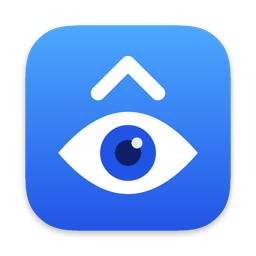
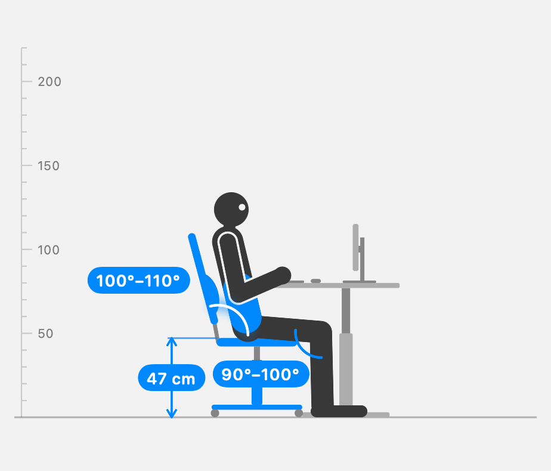

<p align="center">
  
</p>

<h1 align="center">UpGaze</h1>

<p align="center">
  A macOS menu bar app that reminds you to switch between sitting and standing, and to rest your eyes.
</p>

<p align="center">
  <a href="https://github.com/SimeonGK/UpGaze/releases/latest"></a>
  
  <a href="LICENSE"></a>
</p>

<p align="center">
  <a href="https://github.com/SimeonGK/UpGaze/releases/latest/download/UpGaze.dmg"><b>Download UpGaze.dmg</b></a>
</p>

<p align="center">
  
</p>

## Features

- **Sit / stand timer.** 40 minutes sitting and 15 minutes standing by default, both adjustable.
  The menu bar shows your current posture and the minutes left.
- **20-20-20 eye rule.** Every 20 minutes, a 20-second countdown to look at something 6 metres
  (20 feet) away.
- **Workstation setup.** Enter your height and get target heights for your chair, desk and
  monitor, explained in four animated steps.
- **Pauses when you are away.** The timers stop when the screen locks or the Mac sleeps.
- **Dutch and English.** Follows the macOS language, or pick one in Settings.

## Install

1. [Download UpGaze.dmg](https://github.com/SimeonGK/UpGaze/releases/latest/download/UpGaze.dmg),
   open it and drag **UpGaze** to **Applications**.
2. Open UpGaze once. macOS shows a warning, because the app is not signed with a paid Apple
   developer certificate. Click **Done**.
3. Go to **System Settings → Privacy & Security**, scroll to **Security** and click
   **Open Anyway**.

You only need to do this the first time. Requires macOS 14 or later, on Apple silicon or Intel.

## Usage

UpGaze lives in the menu bar; there is no Dock icon. Click it to see the timer, switch posture,
pause, or snooze for 5 minutes. The **Settings** tab has the durations, sounds, launch at login,
language and an update check. **Set up workstation** opens the height guide.

## Build from source

You need Xcode 16 or later. No Apple developer account is required.

```bash
git clone https://github.com/SimeonGK/UpGaze.git
```

```bash
open UpGaze/UpGaze.xcodeproj
```

Then press **Run**.

## Contributing

Issues and pull requests are welcome.

## Privacy

UpGaze collects nothing. Its only network request goes to the GitHub API, and only when you
click **Check for Updates**.

## License

[MIT](LICENSE)
